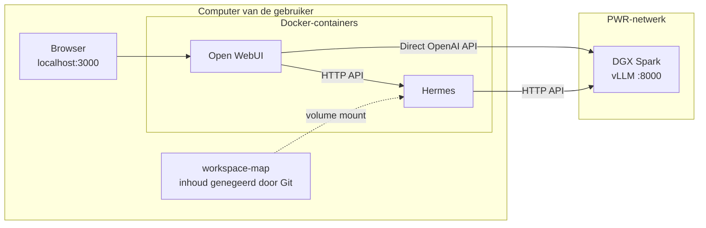

# Persoonlijke Open WebUI + Hermes voor een gedeelde Spark
## Verbinding



## Starten

1. Installeer Docker Desktop en clone deze repo.
2. Kopieer `.env.example` naar `.env`. Gebruik in PowerShell `Copy-Item .env.example .env` (of `cp .env.example .env` op macOS/Linux).
3. Pas `.env` aan: vul `SPARK_IP` in en vervang `API_SERVER_KEY` door een lang, willekeurig geheim.
4. Open PowerShell in de projectmap en start de containers:

   ```powershell
   docker compose up -d
   ```

5. Open http://localhost:3000, maak een account aan en kies `hermes-agent` of `gpt-oss-120b`.

Compose maakt `workspace/` aan als die ontbreekt en koppelt de map aan Hermes. Git negeert alle inhoud van deze map. Alleen deze map is toegankelijk voor Hermes, zodat Hermes geïsoleerd draait.

## Telegram-bot aanmaken

1. Open [@BotFather](https://t.me/BotFather) in Telegram en stuur `/newbot`.
2. Volg de aanwijzingen om de bot een naam en gebruikersnaam te geven. Kopieer de token die BotFather daarna toont naar `TELEGRAM_BOT_TOKEN` in `.env`. Behandel deze token als een wachtwoord en deel hem met niemand.
3. Vul bij `TELEGRAM_ALLOWED_USERS` je numerieke Telegram-gebruikers-ID in. Gebruik alleen ID's van personen die de bot mogen gebruiken; je kunt je ID bijvoorbeeld opvragen via een Telegram-ID-bot die je vertrouwt.
4. Sla `.env` op en herstart de services met `docker compose up -d`.
