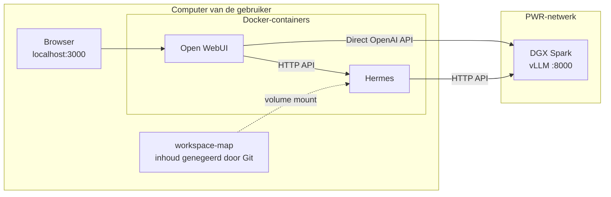

# Persoonlijke Open WebUI + Hermes voor een gedeelde Spark
## Verbinding



## Starten

1. Installeer Docker Desktop en clone deze repo.
2. Open PowerShell in de projectmap en start de containers:

   ```powershell
   docker compose up -d
   ```

3. Open http://localhost:3000, maak een account aan en kies `hermes-agent` of `gpt-oss-120b`.

Compose maakt `workspace/` aan als die ontbreekt en koppelt de map aan Hermes. Git negeert alle inhoud van deze map. Alleen deze map is toegankelijk voor Hermes, zodat Hermes geïsoleerd draait.
